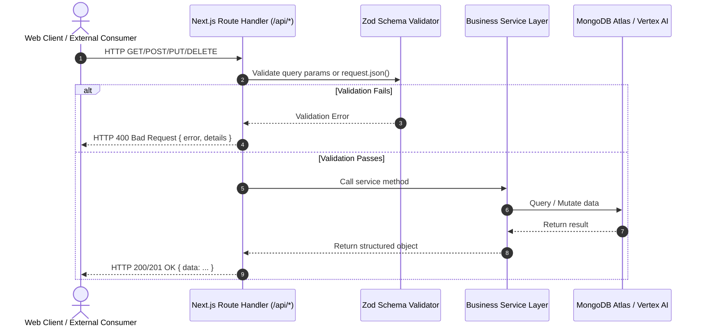

# 📡 REST API Documentation

[← Back to Wiki Home](Home) · [System Architecture](System-Architecture) · [Feature Details](Feature-Details) · [Environment Variables](Environment-Variables)

This document is the official API specification for the **TORBIDD** platform. All endpoints are implemented as server-side Next.js Route Handlers (`src/app/api/`) enforcing strict runtime schema validation via **Zod**.

---

## 🌐 Global API Conventions

### Base URL
- **Local Development**: `http://localhost:3000/api`
- **Production**: `https://<your-domain>/api`

### Content Type & Encodings
- All requests containing bodies must send: `Content-Type: application/json`.
- All JSON responses are UTF-8 encoded with bilingual support (`th` / `en`).

### Standard Response Envelope
Successful responses wrap payloads in a `data` key:
```json
{
  "data": { ... },
  "total": 42,
  "page": 1,
  "totalPages": 5
}
```

### Standard Error Response Format
```json
{
  "error": "BAD_REQUEST",
  "message": "Invalid query parameter or payload schema.",
  "details": [
    { "field": "budgetMin", "issue": "Expected number, received string" }
  ]
}
```

### HTTP Status Codes
| Code | Meaning |
|---|---|
| `200 OK` | Request succeeded. |
| `201 Created` | Resource successfully created. |
| `400 Bad Request` | Validation failed (Zod schema rejection). |
| `401 Unauthorized` | Authentication required (Missing or invalid session cookie). |
| `403 Forbidden` | Access denied (Insufficient role, e.g., non-admin accessing `/api/admin/*`). |
| `404 Not Found` | Requested entity does not exist. |
| `429 Too Many Requests` | Upstream AI provider or scraper rate-limited. |
| `500 Internal Server Error` | Unexpected backend or database exception. |

---

## 🧭 API Request Lifecycle



---

## 📑 API Directory

- [1. Procurement Opportunities & Projects](1.-Procurement-Opportunities-and-Projects-API)
- [2. Historical Price Analysis & Benchmarks](2.-Historical-Price-Analysis-and-Benchmarks-API)
- [3. AI Document Intelligence & Classification](3-ai-document-intelligence--classification)
- [4. User Authentication & Session](4-user-authentication--session)
- [5. Bookmarks & User Settings](5-bookmarks--user-settings)
- [6. Notifications Subsystem](6-notifications-subsystem)
- [7. Document Serving](7-document-serving)
- [8. Ingestion & Administration](8.-ingestion-and-administration-API)

