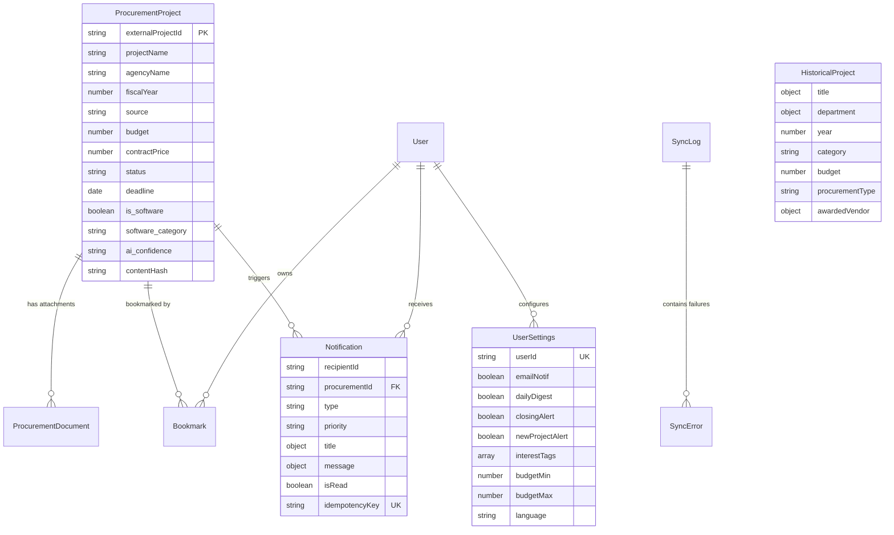

# Database Design & Schema Reference

## 1. Overview

TORBIDD uses **MongoDB Atlas** as its document database. The schema is defined and validated using **Mongoose ODM** with full TypeScript interfaces located under `torbidd-app/src/models/`.

The database is optimized for:
- Full-text search and faceted filtering on procurement categories, agencies, and budgets.
- High-write throughput during automated crawler synchronizations.
- Fast, deduplicated retrieval of notifications and user bookmarks.



---

## 2. Core Collections & Schemas

### 2.1 `ProcurementProject` Collection
Stores both raw and enriched procurement notices discovered from government portals.

```typescript
// Mongoose Schema: src/models/ProcurementProject.ts
{
  externalProjectId: { type: String, required: true, unique: true, index: true },
  projectName: { type: String, required: true, index: 'text' },
  agencyName: { type: String, required: true, index: true },
  fiscalYear: { type: Number, required: true, index: true },
  source: { type: String, required: true, enum: ['BMA', 'e-GP', 'data.go.th'] },
  sourceUrl: { type: String, required: true },
  budget: { type: Number, default: 0, index: true },
  contractPrice: { type: Number },
  medianPrice: { type: Number },
  procurementType: { type: String },
  publishDate: { type: Date, index: true },
  deadline: { type: Date, index: true },
  torStatus: { type: String, enum: ['AVAILABLE', 'NO_TOR', 'PENDING'], default: 'PENDING' },
  summary: {
    th: { type: String },
    en: { type: String }
  },
  requiredTechnologies: [{ type: String, index: true }],
  extractedQualifications: [{
    id: String,
    description: { th: String, en: String },
    category: { type: String, enum: ['Legal', 'Financial', 'Experience', 'Technical'] },
    threshold: String,
    mandatory: Boolean
  }],
  extractionStatus: { type: String, enum: ['PENDING', 'EXTRACTED', 'FAILED'], default: 'PENDING' },
  contentHash: { type: String, index: true },
  revision: { type: Number, default: 1 },
  is_software: { type: Boolean, default: true, index: true },
  software_category: { type: String, index: true },
  ai_confidence: { type: String, enum: ['High', 'Medium', 'Low'] },
  classification_reason: { type: String },
  classified_by: { type: String, enum: ['ai', 'admin', 'rule'], default: 'ai' },
  admin_reviewed: { type: Boolean, default: false, index: true },
  status: { type: String, enum: ['open', 'closingSoon', 'closed', 'awarded', 'cancelled'], default: 'open', index: true }
}
```

### 2.2 `HistoricalProject` Collection
Contains validated historical procurement and awarded contract benchmarks used for budget reasonableness calculations and comparative charts.

```typescript
// Mongoose Schema: src/models/HistoricalProject.ts
{
  title: { th: { type: String, required: true }, en: { type: String, required: true } },
  department: { th: { type: String, required: true }, en: { type: String, required: true } },
  year: { type: Number, required: true, index: true },
  category: { type: String, required: true, enum: ['Website', 'Mobile App', 'AI', 'Database'], index: true },
  budget: { type: Number, required: true, min: 0 },
  description: { th: String, en: String },
  scope: { th: [String], en: [String] },
  procurementType: { type: String },
  awardedVendor: { th: String, en: String }
}
```

### 2.3 `Notification` Collection
Stores user alerts generated by the matching engine and deadline monitoring scanner.

```typescript
// Mongoose Schema: src/models/Notification.ts
{
  recipientId: { type: String, required: true, index: true },
  procurementId: { type: String, required: true, index: true },
  type: {
    type: String,
    required: true,
    enum: ['PROCUREMENT_MATCHED', 'PROCUREMENT_UPDATED', 'DEADLINE_APPROACHING', 'STATUS_CHANGED', 'TOR_UPDATED']
  },
  priority: { type: String, enum: ['LOW', 'MEDIUM', 'HIGH', 'URGENT'], default: 'MEDIUM' },
  title: { th: { type: String, required: true }, en: { type: String, required: true } },
  message: { th: { type: String, required: true }, en: { type: String, required: true } },
  linkUrl: { type: String, required: true },
  isRead: { type: Boolean, default: false, index: true },
  readAt: { type: Date, default: null },
  idempotencyKey: { type: String, unique: true, sparse: true },
  createdAt: { type: Date, default: Date.now, index: true }
}
```

### 2.4 Supporting Collections
- **`Bookmark`**: Junction collection mapping `userId` / `sessionId` to `projectId`. Includes compound index `{ userId: 1, projectId: 1 }`.
- **`UserSettings`**: Holds user notification toggles, budget thresholds (`budgetMin`, `budgetMax`), language preference, and interested category tags (`interestTags`).
- **`SyncLog` & `SyncError`**: Audit logs of crawler runs, recording start/end times, total items processed, new insertions, updates, and stack traces of failed records.

---

## 3. Database Indexes

| Collection | Indexed Fields | Type | Purpose |
|---|---|---|---|
| `ProcurementProject` | `externalProjectId` | Unique | Prevents duplicate ingestion across crawlers |
| `ProcurementProject` | `projectName`, `summary.th`, `summary.en` | Text Search | Multi-lingual keyword search |
| `ProcurementProject` | `is_software`, `status`, `deadline` | Compound | Fast queries for active software tenders |
| `HistoricalProject` | `category`, `year`, `department.th` | Compound | High-speed budget analytics aggregation |
| `Notification` | `recipientId`, `isRead`, `createdAt` | Compound | Chronological user inbox filtering |
| `Notification` | `idempotencyKey` | Unique (Sparse) | Prevents duplicate alerts during sync |