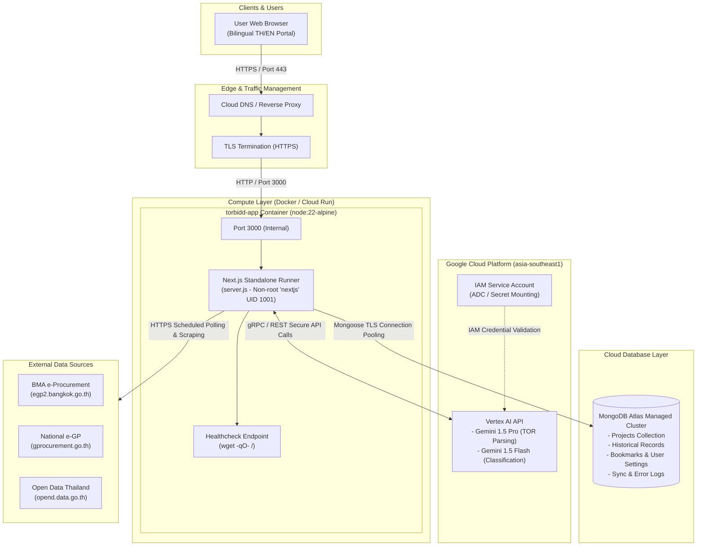
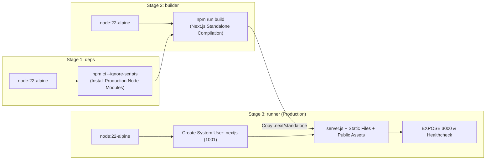
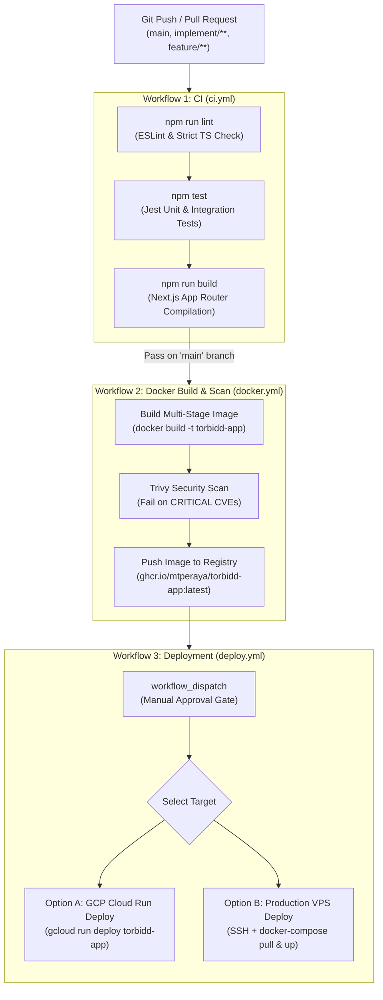

# 🚀 Software Design Document: Deployment Architecture

[← Back to Wiki Home](Home) · [System Architecture](System-Architecture) · [Environment Variables](Environment-Variables) · [Technical Decisions (ADR)](Technical-Decisions)

This document specifies the deployment topology, cloud infrastructure, containerization strategy, and automated CI/CD pipelines powering the **TORBIDD** platform in accordance with **SDD Section 9**.

---

## 1. Environments Overview

TORBIDD operates across three standardized deployment environments:

| Environment | Purpose | Hosting / Runtime | Database | AI Provider Strategy |
|---|---|---|---|---|
| **Local Development** | Active engineering & local testing | Node.js 22 / Docker Compose (`localhost:3000`) | MongoDB Atlas (Dev Cluster) or offline fallback | Google AI Studio (`GEMINI_API_KEY`) or offline mock fixtures |
| **CI / Staging** | Automated linting, test suites, and container build validation | GitHub Actions Runner (`ubuntu-latest`) | Ephemeral / Mocked Atlas connection | Deterministic rule engine & mock AI responses |
| **Production** | Live end-user traffic & scheduled government ingestion | GCP Cloud Run / Docker Container on Alpine Linux | MongoDB Atlas (Production Cluster with Replica Sets) | Google Cloud Vertex AI (`asia-southeast1`) |

---

## 2. Infrastructure Architecture Diagram

The live production topology relies on a containerized Next.js standalone runner deployed on cloud infrastructure, communicating securely with MongoDB Atlas and Google Cloud Platform services.



---

## 3. Containerization Strategy (Docker)

TORBIDD uses a secure, **multi-stage Docker build** based on `node:22-alpine` to minimize image footprint and attack surface (producing an image under 180 MB compared to standard ~1.2 GB Node images).

### 3.1 Multi-Stage Build Pipeline



### 3.2 Dockerfile Stages Breakdown

| Stage | Base Image | Role | Output Artifacts |
|---|---|---|---|
| **1. `deps`** | `node:22-alpine` | Installs dependencies with `npm ci --legacy-peer-deps`. Installs `libc6-compat` for Alpine compatibility. | Cached `/app/node_modules` |
| **2. `builder`** | `node:22-alpine` | Compiles TypeScript, bundles Next.js App Router, and creates standalone output (`output: 'standalone'`). | `/app/.next/standalone` & `/app/.next/static` |
| **3. `runner`** | `node:22-alpine` | Lightweight production runtime without package managers or development dependencies. Runs as non-root user `nextjs:nodejs`. | Production executable container |

### 3.3 Security & Runtime Health
- **Non-Root Execution**: Runs strictly under unprivileged user `nextjs` (UID: 1001, GID: 1001).
- **Built-in Healthcheck**: Configured to poll every 30 seconds with 10s timeout:
  ```dockerfile
  HEALTHCHECK --interval=30s --timeout=10s --start-period=15s --retries=3 \
    CMD wget -qO- http://localhost:3000/ || exit 1
  ```
- **Entrypoint**: `CMD ["node", "server.js"]`

---

## 4. Multi-Container Orchestration (Docker Compose)

For local staging, reproduction, and database seeding, TORBIDD provides `docker-compose.yml`.

### Services Definition
- **`app` Service**: Runs the production standalone Next.js server on port `3000:3000`, reading configuration from `.env.local`.
- **`seed` Service (Profile-scoped)**: Specialized utility service based on the `builder` target containing seeding scripts (`scripts/seed.ts`). Runs only on demand via the `--profile seed` flag:
  ```bash
  # Execute one-time initial seed against Atlas cluster:
  docker compose --profile seed run seed
  ```

---

## 5. CI/CD Pipeline (GitHub Actions)

Continuous Integration and Continuous Deployment are managed via three automated GitHub Actions workflows located in `.github/workflows/`:



### 5.1 Pipeline Summary

| Workflow File | Trigger Events | Key Steps | Success Criteria |
|---|---|---|---|
| **`ci.yml`** | Push & PRs to `main`, `implement/**`, `feature/**`, `fix/**` | 1. Checkout repository<br>2. Setup Node.js 22 with npm cache<br>3. `npm ci`<br>4. TypeScript check & ESLint<br>5. Run Jest test suite<br>6. Execute build verification | All unit tests pass, zero lint warnings, static build succeeds. |
| **`docker.yml`** | Push to `main` branch or manual trigger | 1. Build Docker image using multi-stage targets<br>2. Run **Trivy Vulnerability Scanner**<br>3. Push image tagged with Git SHA and `latest` to GitHub Container Registry (`ghcr.io`) | Zero Critical/High CVEs; image uploaded to GHCR. |
| **`deploy.yml`** | Manual `workflow_dispatch` | 1. Authenticate with cloud target<br>2. Pull latest container from GHCR<br>3. Perform rolling container restart with health verification | Healthcheck returns HTTP 200 within 30 seconds. |

---

## 6. Cloud & Hosting Configuration

### 6.1 Google Cloud Platform (Compute & AI)
- **Region**: `asia-southeast1` (Bangkok / Singapore latency-optimized).
- **Compute Target (Option A)**: **Google Cloud Run** (Fully managed serverless container platform).
  - Memory: 1 GiB – 2 GiB per instance.
  - Concurrency: 80 requests per container.
  - Autoscaling: Scale to 0 on idle (with warm minimum instances if cold-starts require mitigation).
- **AI Integration**: Service account granted `roles/aiplatform.user` for Vertex AI Gemini API calls.

### 6.2 Target Host (Option B - Self-Hosted VPS / VM)
- **Specification**: 2 vCPU, 4 GB RAM, Ubuntu 24.04 LTS.
- **Reverse Proxy**: Nginx or Traefik handling TLS termination with Let's Encrypt automated certificates.
- **Container Runtime**: Docker Engine 26+ with Docker Compose v2.

### 6.3 Database Hosting (MongoDB Atlas)
- **Deployment**: Managed Atlas cluster with automated daily snapshots and connection encryption (TLS 1.3).
- **Connection Optimization**: Unified singleton client caching connections in `src/services/database/` across serverless or container restarts.

---

## 7. Deployment Runbook

### Local Production Build & Run
```bash
# 1. Prepare environment variables
cp torbidd-app/.env.example torbidd-app/.env.local
# (Edit .env.local with your real MONGODB_URI and credentials)

# 2. Build the production Docker image
docker build -t torbidd-app ./torbidd-app

# 3. Run the container
docker run -d -p 3000:3000 --env-file torbidd-app/.env.local --name torbidd-live torbidd-app

# 4. Check container health
docker ps
curl http://localhost:3000/api/projects
```

### Production Docker Compose Deployment
```bash
# Pull latest container image and restart with zero downtime
docker compose pull app
docker compose up -d --remove-orphans app

# View live container logs
docker compose logs -f app