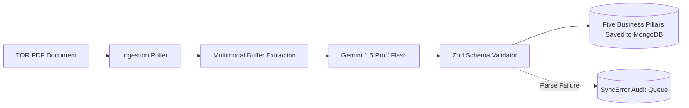

## FEAT-02: AI TOR Document Extraction & Classification
[← Back to Feature Details](Feature-Details)

### 1. Overview & Purpose
Ingests dense government Terms of Reference (TOR) PDF documents (~50 pages), extracts critical contractual clauses, determines whether the project is software-related, and populates the **Five Core Business Pillars**.

### 2. Architecture & Components
- **Orchestration**: `src/services/ai/ai-orchestration.ts`
- **AI Providers**:
  - `GoogleCloudVertexAIService` (Gemini 1.5 Pro for multimodal extraction, Gemini 1.5 Flash for classification)
  - `GoogleAIStudioService` (Gemini 2.5 Flash for rapid API key rotation)
  - `FallbackKeywordClassifier` (Deterministic offline rule engine)
- **Primary Models**: `ProcurementDocument.ts`, `SystemMetadata.ts`

### 3. Extraction Capabilities (The Five Pillars)
1. **Commercial & Financial Profile**: Budget, Reference Price (*ราคากลาง*), Procuring Agency, Thai Fiscal Year (*ปีงบประมาณ*), Procurement Method (*e-Bidding*).
2. **Executive Scope & Objectives**: Executive briefing, Work Scope (*ขอบเขตงาน*), Contract Period, Maintenance Terms.
3. **Technical Fit & Delivery Feasibility**: Core Tech Stack (e.g., Oracle, Kubernetes, DICOM 3.0), Technical Compliance Checklist, SLA, Support Hours, PDPA/ISO compliance.
4. **Bidder Qualification & Compliance Gates**:
   - **Legal Gate**: Thai registration, no government blacklist.
   - **Experience Gate**: Qualifying past government/enterprise contracts within domain and period.
   - **Financial Gate**: Minimum paid-up capital, audited financial statements.
   - **Technical Gate**: Required certifications (ISO/IEC 29110, CMMI Level 3+).
5. **Bid Submission Roadmap**: Exact closing date and time, document purchase window, award and delivery milestones.

---
