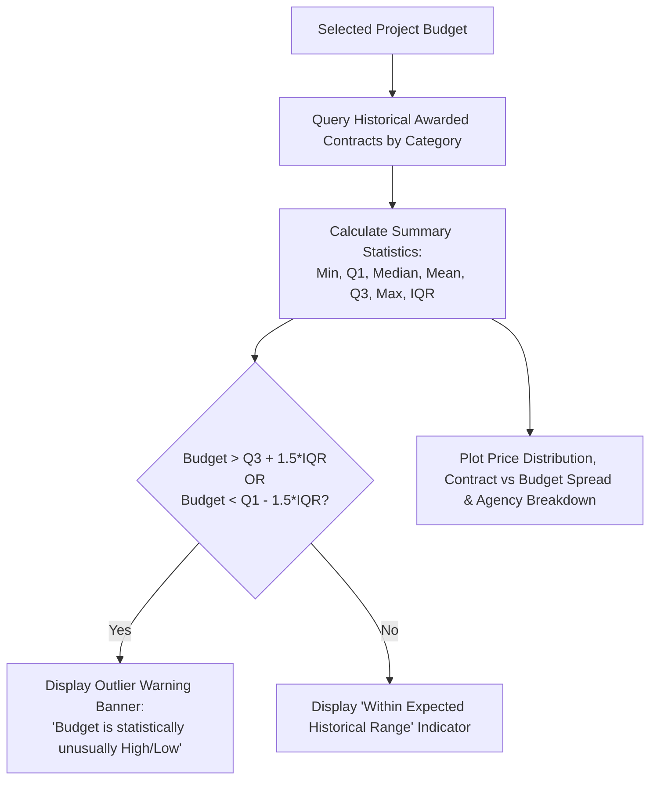

## FEAT-04: Historical Price Benchmarking & Outlier Engine
[← Back to Feature Details](Feature-Details) · [API Specification](2.-Historical-Price-Analysis-and-Benchmarks-API)

### 1. Overview & Purpose
Empowers technology bidders and analysts to formulate competitive, evidence-based pricing strategies by comparing current procurement budgets against historical awarded contracts across the Bangkok Metropolitan Administration (BMA) and central government agencies.

### 2. Architecture & Components
- **UI Component**: `src/app/historical/page.tsx`, `src/components/historical/`
- **Route Handler**: `GET /api/historical`
- **Primary Models**: `src/models/HistoricalProject.ts`, `src/models/ProcurementProject.ts`
- **Visualization Library**: `Chart.js` + `react-chartjs-2`
- **Analytics Engine**: `src/lib/historicalAnalytics.ts`

### 3. Redesigned Interface & Statistical Analytics

The historical price analytics interface has been redesigned for streamlined clarity:
1. **Summary Benchmark KPI Cards**:
   - **Category Median**: Central reference benchmark ($Q2$).
   - **Mean Budget**: Average project scale.
   - **Interquartile Range (IQR)**: Statistical middle-50% spread.
   - **Sample Project Count**: Total verified historical awards analyzed.
2. **Interactive Visualizers**:
   - **Price Distribution & Percentile Bar**: Displays Minimum, 25th percentile ($Q1$), 50th percentile (Median), 75th percentile ($Q3$), Maximum, and outlier boundary gates.
   - **Contract Price vs. Allocated Budget Spread**: Evaluates the typical discount/savings percentage achieved between published median prices and awarded contract values.
   - **Agency Spending Breakdown**: Aggregated departmental procurement volume across municipal offices.

### 4. Statistical Algorithms

- **Five-Number Summary**:
  $$\text{Summary} = [\text{Min}, Q_1, \text{Median}, Q_3, \text{Max}]$$
- **Interquartile Range (IQR)**:
  $$\text{IQR} = Q_3 - Q_1$$
- **Tukey Outlier Boundary Gates**:
  - **High Outlier Threshold**: $\text{UpperBound} = Q_3 + 1.5 \times \text{IQR}$
  - **Low Outlier Threshold**: $\text{LowerBound} = \max(0, Q_1 - 1.5 \times \text{IQR})$
- **Null-Safe Aggregation**: Automatically filters zero or malformed budget records and degrades gracefully when category sample counts are low.

### 5. Automated Verification
- `src/lib/__tests__/historicalAnalytics.test.ts`: Verifies median computation, quartile calculation, and outlier detection logic.
- `src/components/historical/__tests__/HistoricalComponents.test.tsx`: Asserts correct rendering of metric cards, charts, and empty states.
