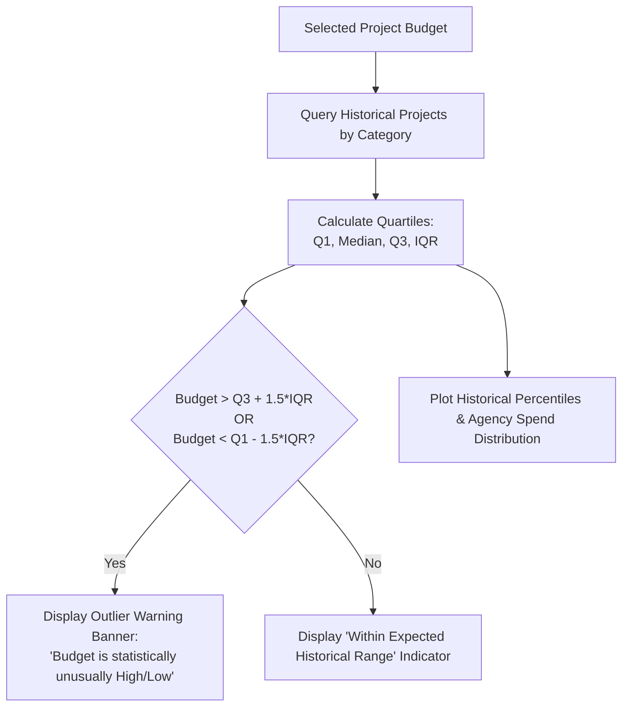

## FEAT-04: Historical Price Benchmarking & Outlier Engine
[← Back to Feature Details](Feature-Details)

### 1. Overview & Purpose
Empowers technology bidders to formulate competitive pricing strategies by comparing current procurement budgets against historical awarded contracts across BMA and central government agencies.

### 2. Architecture & Components
- **UI Component**: `src/components/analytics/HistoricalAnalyticsView.tsx`, `BoxPlotChart.tsx`
- **Route Handler**: `GET /api/historical`
- **Primary Model**: `src/models/HistoricalProject.ts`
- **Visualization**: `Chart.js` + `react-chartjs-2`

### 3. Statistical Algorithms
- **Five-Number Summary**: Minimum, First Quartile (Q1), Median, Third Quartile (Q3), Maximum.
- **Interquartile Range (IQR)**:
 
IQR=Q3-Q1
- **Outlier Boundary Gates**:
  - High Outlier Threshold: UpperBound=Q3+1.5IQR
  - Low Outlier Threshold: LowerBound=Q1-1.5IQR
- **Agency Analytics Aggregation**: Total budget spend, project counts, and average contract sizes across agencies.

---
