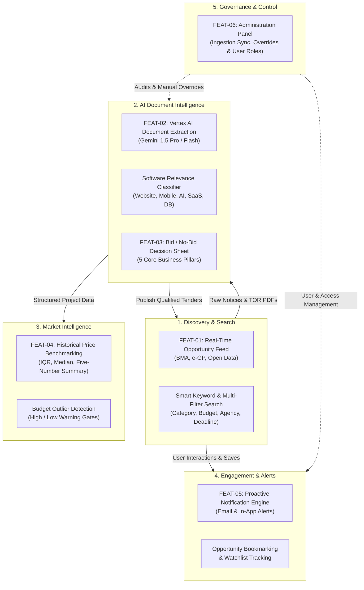

# 🌟 Feature Overview

[← Back to Wiki Home](Home) · [Feature Details](Feature-Details) · [Use Case Documentation](Use-Case-Documentation) · [Requirement Traceability](Requirement-Traceability)

The **TORBIDD Software Procurement Intelligence Platform** (*แพลตฟอร์มข่าวกรองการจัดซื้อจัดจ้างซอฟต์แวร์ภาครัฐ*) bridges the information gap between Thai government agencies and technology vendors. By combining automated procurement ingestion, large language model (LLM) document intelligence, and historical pricing analytics, TORBIDD transforms dense legal tender notices into actionable business opportunities.

---

## 🗺️ Feature Capability Map

---

## 📋 Core Feature Modules At a Glance

| Module | Feature Name | SRS Reference | Primary Value Proposition | Status |
|---|---|---|---|---|
| **FEAT-01** | [Procurement Discovery & Search Feed](Feature-Details#feat-01-real-time-procurement-discovery--search-feed) | 3.3, 3.4 | Unified public tender feed with multifaceted filtering and urgent deadline highlights. | `🟢 Stable` |
| **FEAT-02** | [AI TOR Extraction & Classification](Feature-Details#feat-02-ai-tor-document-extraction--classification) | 3.5, 3.6 | Converts ~50-page Thai legal PDFs into structured data and filters out non-software tenders. | `🟢 Stable` |
| **FEAT-03** | [Procurement Detail & Bid/No-Bid Sheet](Feature-Details#feat-03-procurement-detail-viewer--bidno-bid-decision-sheet) | 3.7 | Executive 5-pillar dossier evaluating commercial attractiveness, tech fit, and legal gates. | `🟢 Stable` |
| **FEAT-04** | [Historical Price & Outlier Analytics](Feature-Details#feat-04-historical-price-benchmarking--outlier-engine) | 3.9, 3.10 | Statistical pricing benchmarks (median, IQR) and budget anomaly detection against past awards. | `🟢 Stable` |
| **FEAT-05** | [Proactive Notification & Bookmarks](Feature-Details#feat-05-proactive-notification--bookmark-engine) | 3.8, 3.11, 3.12 | Personalized alerts for new matching tenders, deadline countdowns, and document revisions. | `🟢 Stable` |
| **FEAT-06** | [Administration & Ingestion Monitoring](Feature-Details#feat-06-administration-panel--ingestion-audit-monitoring) | 3.13 | Real-time scraper sync monitoring, AI classification overrides, and user role management. | `🟢 Stable` |

---

## 🔍 Module Summaries

### 1. Procurement Discovery & Smart Search Feed (FEAT-01)
- **Centralized Public Feed**: Aggregates software opportunities from the Bangkok Metropolitan Administration (BMA), national e-GP, and Open Data Thailand (`data.go.th`).
- **Multifaceted Filtering**: Instant client-side and server-side filtering across Project Category, Issuing Agency, Estimated Budget bracket, and Submission Deadline.
- **Approaching Deadline Badges**: Automatically flags and prioritizes projects closing within 7 days.

### 2. AI TOR Document Extraction & Classification (FEAT-02)
- **Multimodal Document Understanding**: Leverages Google Cloud Vertex AI (Gemini 1.5 Pro and Gemini 1.5 Flash) with fallback options to extract structured data directly from Thai TOR PDF files.
- **Software Relevance Gate**: Evaluates tenders against software criteria (Website Development, Mobile Applications, Information Systems, AI Solutions, Database Systems, Software Maintenance, and Software Licenses/Subscriptions/SaaS). Non-software items are excluded from public feeds.
- **Confidence Scoring**: Records AI extraction and classification confidence scores for administrative quality auditing.

### 3. Detail Viewer & Executive Bid/No-Bid Decision Sheet (FEAT-03)
Organizes all extracted procurement information into the **Five Core Business Pillars** confirmed by the client:
1. **Commercial & Financial Profile**: Allocated budget, reference price (*ราคากลาง*), procuring agency, Thai fiscal year (*ปีงบประมาณ*), procurement method.
2. **Executive Scope & Strategic Objectives**: Executive summary, deliverables checklist, contract duration, warranty terms.
3. **Technical Fit & Delivery Feasibility**: Core tech stack, compliance checklist, availability/SLA targets, support windows, and regulatory compliance (PDPA, Computer Crime Act, ISO 27001).
4. **Bidder Qualification & Compliance Gates**: Mandatory Legal gates (Thai business registration, blacklists), Experience gates (past performance), Financial gates, and Technical certifications (ISO/IEC 29110, CMMI Level 3+).
5. **Bid Submission & Execution Roadmap**: Announcement date, document purchase window, exact submission deadline timestamp, and delivery milestones.
- **Direct Source Verification**: Direct link and embedded viewer for the original government TOR PDF.

### 4. Historical Pricing & Outlier Benchmarks (FEAT-04)
- **Comparative Intelligence**: Cross-references selected opportunities against historical awarded government contracts in the same category.
- **Statistical Benchmark Metrics**: Computes Five-Number Summaries (Min, Q1, Median, Q3, Max) and Interquartile Ranges (IQR).
- **Outlier Warning Engine**: Generates visual warnings if an opportunity’s budget deviates significantly from historical averages ($>\text{Q3} + 1.5\times\text{IQR}$ or $<\text{Q1} - 1.5\times\text{IQR}$).
- **Agency Procurement Trends**: Visualizes spend distribution and average contract values across municipal departments.

### 5. Proactive Notification & Personalization Engine (FEAT-05)
- **Customized Opportunity Alerts**: Notifies registered users via in-app alerts and daily email digests when a new procurement matches their saved interest tags and budget brackets.
- **Saved Watchlists & Bookmarks**: Allows users to save opportunities to their personal watchlist.
- **Lifecycle & Deadline Reminders**: Automated alerts triggered at 3 days and 24 hours prior to bid submission closing, or when an amended TOR document is published.

### 6. Administration Panel & Pipeline Governance (FEAT-06)
- **Ingestion Telemetry**: Real-time status tracking of data sync pipelines across external government portals (`SyncLog` and `SyncError`).
- **Classification Override**: Review interface for administrators to verify borderline tenders or correct false-positive classifications.
- **User Role Management**: Administrative controls to view user activity, assign administrative permissions, or suspend accounts.

---

## 👥 Persona & Feature Access Matrix

| Feature / Capability | Guest / Public Visitor | Registered Vendor / Bidder | System Administrator |
|---|:---:|:---:|:---:|
| Browse Public Opportunity Feed | ✅ | ✅ | ✅ |
| Smart Keyword & Multi-Filter Search | ✅ | ✅ | ✅ |
| View Basic Opportunity Metadata | ✅ | ✅ | ✅ |
| View Full Bid/No-Bid Decision Sheet | ✅ | ✅ | ✅ |
| Download Original Government TOR PDF | ✅ | ✅ | ✅ |
| View Historical Pricing & Outlier Warnings | 🔒 Sign-In Prompt | ✅ | ✅ |
| Bookmark Opportunities & Save Watchlists | 🔒 Sign-In Prompt | ✅ | ✅ |
| Configure Keyword & Category Alerts | 🔒 Sign-In Prompt | ✅ | ✅ |
| Receive Email & In-App Notifications | 🔒 Sign-In Prompt | ✅ | ✅ |
| Monitor Scraper Health & Sync Logs | ❌ | ❌ | ✅ |
| Override AI Classifications / Extraction | ❌ | ❌ | ✅ |
| Manage User Roles & Account Status | ❌ | ❌ | ✅ |
