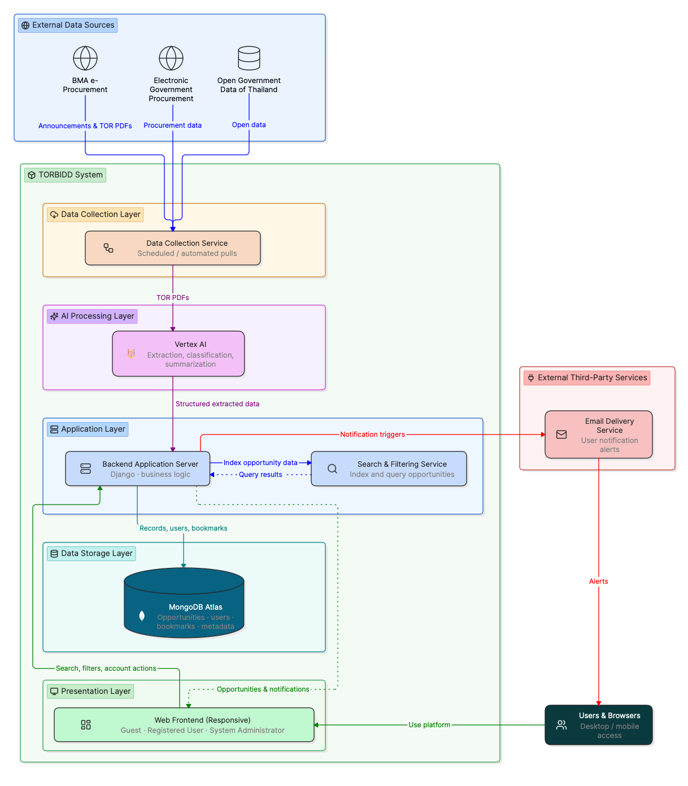

# 🏛️ TORBIDD Wiki

Welcome to the official documentation and engineering source of truth for the **TORBIDD Software Procurement Intelligence Platform** (*แพลตฟอร์มข่าวกรองการจัดซื้อจัดจ้างซอฟต์แวร์ภาครัฐ*).

TORBIDD is an AI-powered intelligence and analytics platform designed to help technology vendors discover Thai government and municipal software procurement opportunities, parse complex Terms of Reference (TOR) specifications using Google Cloud Vertex AI (Gemini 1.5) and Google AI Studio, perform Go/No-Go qualification evaluations, and benchmark historical pricing.

---

## 📖 How to Read & Use This Wiki

This wiki is designed as a structured **living repository and source of truth** for developers, project managers, and evaluators. To navigate efficiently, please review the conventions below.

### 1. Hub-and-Spoke Navigation Pattern
Major documentation categories use a **Parent Hub (Index Page)** structure:
- Clicking a primary section (e.g., [Use Case Documentation](Use-Case-Documentation) or [Feature Details](Feature-Details)) leads you to a **Master Index page**.
- The index page provides a high-level summary, status badges, and deep links to specific, dedicated child pages (e.g., `UC-01-Tender-Discovery`, `FEAT-02-AI-TOR-Extraction`).
- Each child page maintains a breadcrumb link at the top to return to its parent hub and to the wiki home page.

```
[Wiki Home]
   ├── [Use Case Documentation (Index)] ───► [UC-01]
   │                                   └───► [UC-02]
   │
   ├── [Feature Details (Index)] ──────────► [FEAT-01]
   │                                   └───► [FEAT-02]
   │
   └── [API Documentation (Index)] ────────► [API: Projects Endpoints]
                                       └───► [API: Historical & Benchmarks]
```

### 2. Suggested Reading Paths by Role

| If You Are... | Recommended Reading Path |
|---|---|
| 👨‍💻 **Software Developer / DevOps** | 1. [Development Setup](Development-Setup)<br>2. [System Architecture](System-Architecture)<br>3. [Database Design](Database-Design)<br>4. [API Documentation](API-Documentation)<br>5. [Security Considerations](Security-Considerations) |
| 📋 **Product Owner / Evaluator** | 1. [Software Requirements Specification (SRS)](https://github.com/MTPeraya/TORBIDD/blob/main/docs/TORBIDD_SRS.pdf)<br>2. [Feature Overview](Feature-Overview)<br>3. [Use Case Documentation](Use-Case-Documentation)<br>4. [Requirement Traceability](Requirement-Traceability) |
| 🧪 **QA Engineer / Tester** | 1. [Requirement Traceability](Requirement-Traceability)<br>2. [Testing Documentation](Testing-Documentation)<br>3. [Notification Requirements](Notification-Requirements) |
| 🛡️ **Security & Infra Reviewer** | 1. [Security Considerations](Security-Considerations)<br>2. [Deployment Architecture](Deployment-Architecture)<br>3. [Technical Decisions (ADR)](Technical-Decisions) |

### 3. Documentation Status Badges
Pages in this wiki indicate their current review state using standardized badges:
- `🟢 Stable` — Approved and aligned with the active codebase.
- `🟡 In Progress` — Actively being drafted or updated.
- `🔵 RFC / Proposed` — Under architectural review before implementation.

---

## 🧭 System Architecture



---

## 📚 Documentation Catalog

### 1. Project Governance & Specifications
- [Project Source of Truth & Documentation Guidelines](Project-Source-of-Truth-&-Documentation-Guidelines)
- [Software Requirements Specification (SRS)](https://github.com/MTPeraya/TORBIDD/blob/main/docs/TORBIDD_SRS.pdf)
- [Project Proposal & Feasibility](https://github.com/MTPeraya/TORBIDD/blob/main/docs/TORBIDD_Proposal.pdf)
- [Technical Decisions (ADR)](Technical-Decisions)

### 2. Software Design Documents (SDD)
- [System Architecture](System-Architecture)
  - Architectural layers, system context diagram, and data flow sequences.
- [Database Design](Database-Design)
  - Entity-Relationship (ER) diagram, Mongoose schemas, and indexing strategies.
- [External Interfaces & API Documentation](API-Documentation) *(Index Page)*
  - RESTful endpoints, query parameters, payload contracts, and error responses.
- [Security Considerations & Hardening](Security-Considerations)
  - OWASP ASVS v4.0.3 Level 2 mapping, critical threat mitigations (T-01 to T-18), path traversal defense, and SSRF allowlisting.
- [Deployment Architecture](Deployment-Architecture)
  - Docker multi-stage builds, GitHub Actions CI/CD pipelines, and environment configurations.

### 3. 📋 Requirements & Features
- [Feature Overview](Feature-Overview)
  - High-level overview of functional capabilities and platform modules.
- [Feature Details](Feature-Details) *(Index Page)*
- [Use Case Documentation](Use-Case-Documentation) *(Index Page)*
- [Requirement Traceability](Requirement-Traceability)
  - Traceability mapping from SRS requirements (AUTH, DASH, SRCH, EXTR, CLAS, DETL, NOTF, HIST, OUTL, BOOK, PROF, ADMN, NFR) to code modules and tests.
- [Notification Requirements](Notification-Requirements)
  - Subsystem specification for matching rules, event triggers, deduplication, and SMTP email alerts.

### 4. Development & Engineering Guides
- [Development Setup](Development-Setup)
  - Local environment prerequisites, package installation, Docker Compose, and execution.
- [Environment Variables Setup](Environment-Variables)
  - MongoDB Atlas connection pooling, AI provider keys, SMTP credentials, and security flags.
- [GitHub Project & Task Management](Project-Task-Management)
  - Branching conventions (`feature/short-desc`), PR review workflow, and project board.
- [GitHub Wiki Synchronization](README)
  - Automated bidirectional synchronization between GitHub Wiki and the `docs/wiki/` repository directory.

### 5. Testing & Quality Assurance
- [Testing Documentation](Testing-Documentation) *(Index Page)*
  - Multi-tier testing strategy, Jest unit & integration suites, security tests, and test inventory.

---

## 🛠️ Project Technology Stack

| Layer | Technology | Details / Purpose |
|---|---|---|
| **Frontend Framework** | **Next.js 16 (App Router) + React 19** | Server & Client Components, Responsive UI |
| **Language** | **TypeScript (Strict Mode)** | Full-stack end-to-end type safety |
| **Styling** | **Custom CSS Variables Design System** | Accessible bilingual support (TH/EN) & Clean Light Theme (Dark mode removed globally) |
| **Backend & APIs** | **Node.js (Next.js Route Handlers)** | Server-side execution, proxying, and analytics computation |
| **Database** | **MongoDB Atlas + Mongoose** | Managed document store with connection pooling, transactions, and compound indexes |
| **AI / LLM Integration** | **Google Cloud Vertex AI & Google AI Studio** | Multi-provider architecture with automatic fallback (`gemini-1.5-pro`, `gemini-1.5-flash`, `gemini-2.5-flash`, OpenRouter, and Keyword rules) |
| **Data Visualization** | **Chart.js + react-chartjs-2** | Historical pricing distributions, benchmarks, contract vs budget spread, and spend trends |
| **Validation & Schema** | **Zod** | Runtime request body, query parameter, and configuration validation |
| **Notifications & Email** | **Nodemailer SMTP Service** | Responsive HTML templates for opportunity alerts and 72h/24h deadline reminders |
| **Security & Compliance** | **OWASP ASVS v4.0.3 Level 2** | HSTS, strict CSP with reporting, SSRF filtering, path traversal containment defense, `__Host-` session cookies |
| **Containerization** | **Docker (Multi-stage Node:22-Alpine)** | Production standalone build (`docker-compose.yml`) |
| **CI/CD** | **GitHub Actions** | Automated linting, Jest testing, Docker building, CodeQL, and bidirectional wiki sync |

---

## 🔗 Project Resources

- 💻 **Source Code Repository**: [MTPeraya/TORBIDD](https://github.com/MTPeraya/TORBIDD)
- 📋 **GitHub Project Board**: [TORBIDD Sprint Board](https://github.com/users/MTPeraya/projects/2/views/1)
- 📄 **SRS Document**: [`docs/TORBIDD_SRS.pdf`](https://github.com/MTPeraya/TORBIDD/blob/main/docs/TORBIDD_SRS.pdf)
- 📖 **Local Wiki Directory**: [`docs/wiki/`](README.md)
