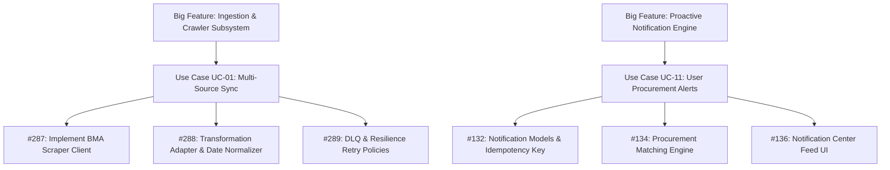

# Project & Task Management

## 1. Management Methodology

The TORBIDD engineering team uses **GitHub Projects (v2)**, **GitHub Issues**, and **Git Flow / GitHub Flow** branching strategies to coordinate development.

- **GitHub Project Board**: [TORBIDD Project Board](https://github.com/users/MTPeraya/projects/2/views/1)
- **Repository**: [https://github.com/MTPeraya/TORBIDD](https://github.com/MTPeraya/TORBIDD)

---

## 2. Issue Hierarchy & Taxonomy

To preserve requirement traceability, development tasks adhere to a three-tier hierarchy:

$$\textbf{Big Feature} \longrightarrow \textbf{Use Case (UC)} \longrightarrow \textbf{Subtasks / Technical Issues}$$

---

## 3. GitHub Project Board Columns & Workflow

| Column | Criteria for Placement |
|---|---|
| **Backlog** | Identified user stories and potential features not yet scheduled for the active milestone. |
| **Todo** | Prioritized subtasks scoped for the active iteration with completed technical requirements. |
| **In Progress** | Work actively being coded on an assigned feature branch. |
| **In Review** | Pull Request opened, automated CI test suites passing, awaiting peer review. |
| **Done** | PR merged into `main`, automated unit/integration tests verified, documentation updated. |

---

## 4. Branching & Commit Conventions

### 4.1 Branch Naming Scheme
- `feature/<issue-number>-<short-description>` (e.g. `feature/134-matching-engine`)
- `bug/<issue-number>-<short-description>` (e.g. `bug/299-bookmark-realtime-update`)
- `refactor/<short-description>` (e.g. `refactor/replace-any-types`)

### 4.2 Commit Message Standards
TORBIDD follows the **Conventional Commits** specification:
- `feat:` Adds a new user-facing capability or API endpoint.
- `fix:` Bug fix in implementation code.
- `test:` Adding or updating unit/integration test suites.
- `refactor:` Code improvements without altering behavior.
- `docs:` Updates to README, Wiki, or architectural documentation.

*Example*: `feat: add deadline sorting and filter out awarded contracts from active listings (#287)`