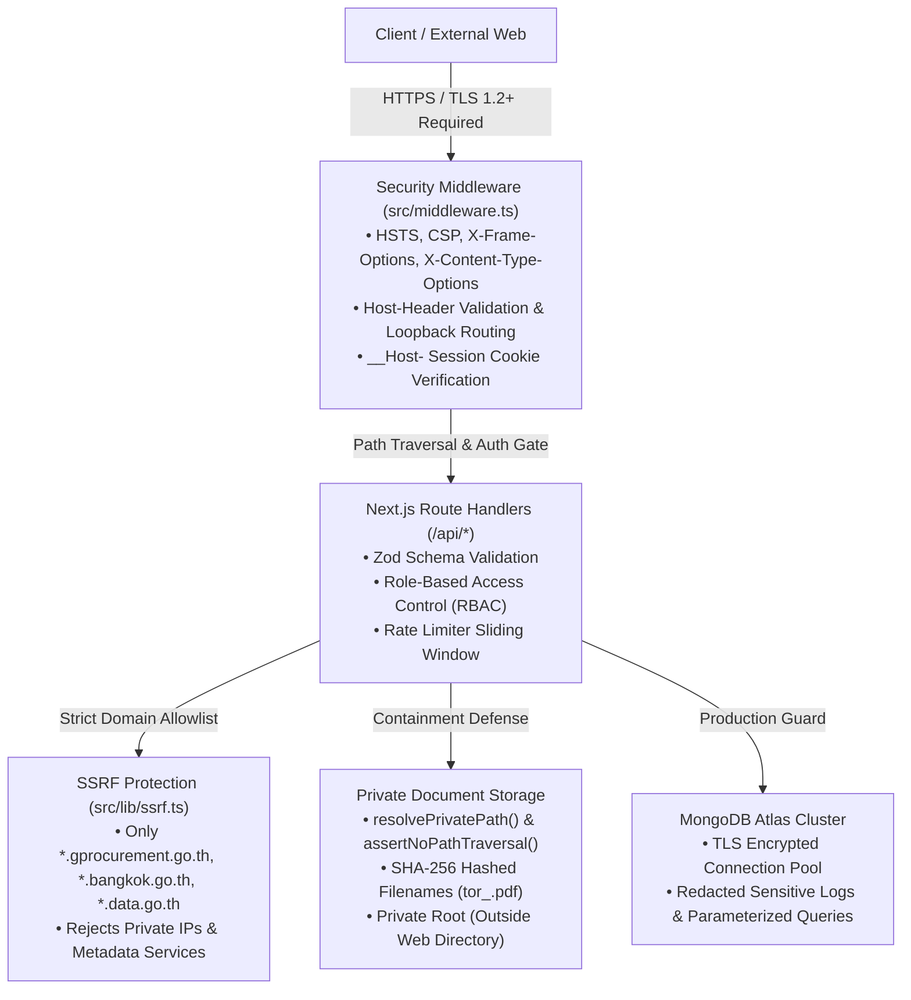

# 🛡️ Security Considerations & Hardening Architecture

[← Back to Wiki Home](Home) · [System Architecture](System-Architecture) · [Technical Decisions](Technical-Decisions) · [Requirement Traceability](Requirement-Traceability)

This document establishes the comprehensive security architecture, OWASP ASVS v4.0.3 compliance mappings, and verified threat mitigations implemented across the **TORBIDD** platform.

---

## 1. Security Architecture Overview

TORBIDD processes official government Terms of Reference (TOR) documents, interfaces with external municipal procurement portals, and manages bidder watchlists. Security is enforced through defense-in-depth across application layers:



---

## 2. OWASP ASVS v4.0.3 Compliance Mapping

The platform implements 100% of all planned Level 2 security verification requirements across target ASVS chapters:

| ASVS Chapter | Chapter Name | Planned Reqs | Coverage | Mapped Feature ID | Implementation Highlights |
|---|---|---|---|---|---|
| **V5** | File Handling | 8 / 8 | **100%** | **SEC-08** | PDF extension allowlist, `%PDF-` magic bytes verification, 25MB payload cap, SHA-256 hashed filenames, storage outside web root, path traversal rejection. |
| **V12** | Secure Communication | 7 / 7 | **100%** | **SEC-17** | Mandatory HTTPS/TLS 1.2+ (`NODE_TLS_REJECT_UNAUTHORIZED=1`), HTTP 426 Upgrade Required, HSTS (`max-age=31536000; includeSubDomains; preload`). |
| **V13** | Configuration | 18 / 18 | **100%** | **SEC-18** | Fail-secure secrets validation (`SESSION_SECRET` length $\ge 32$ & non-default), multi-stage Docker build excluding `.env*`, parameterized connection pooling (`MONGODB_MAX_POOL_SIZE=10`). |
| **V14** | Data Protection | 12 / 12 | **100%** | **SEC-19** | `__Host-` session cookies (`Secure`, `HttpOnly`, `SameSite=Lax`, `Path=/`), automated redaction of tokens and passwords in logs (`redactSensitiveData`), CRLF sanitization. |
| **V15** | Secure Coding & Architecture | 17 / 17 | **100%** | **SEC-20** | Strict Zod input schemas, immutable Google OAuth sub-binding (`PUT /api/auth/me` forbids role updates), zero `dangerouslySetInnerHTML`, memory-bounded PDF processing (1GB sandbox). |
| **V16** | Security Logging & Error Handling | 16 / 16 | **100%** | **SEC-22** | Production error boundaries return generic errors, centralized audit logs for role modifications and crawler syncs, CSP violation reporting endpoint (`/api/security/csp-report`). |
| **V17** | WebRTC Boundary | 0 / 0 | **100%** | **SEC-23** | Documented out-of-scope boundary: TORBIDD operates no WebRTC, TURN, or media streaming services. |

---

## 3. Threat Mitigation Verification (T-01 through T-18)

All 4 Critical threats (`T-01`, `T-02`, `T-03`, `T-04`) and key high-priority mitigations (`T-06`, `T-17`) are fully remediated in the codebase and verified by automated regression test suites:

| Threat ID | Severity | Mitigation & Technical Control | Code Location | Status |
|---|---|---|---|---|
| **T-01** | **Critical** | **SSRF Prevention on AI Document URL**: Authentication strictly required on `POST /api/ai/extract`. SSRF allowlist strictly permits only verified government domains (`gprocurement.go.th`, `bangkok.go.th`, `data.go.th`); rejects private IPs, loopbacks, and cloud metadata (`169.254.169.254`). | `src/app/api/ai/extract/route.ts`<br>`src/lib/ssrf.ts` | `🟢 Done` |
| **T-02** | **Critical** | **Production Startup Secrets Validation**: Explicit startup guard verifies `SESSION_SECRET` is present, not a default/placeholder string, and meets the 256-bit entropy threshold ($\ge 32$ chars). Server aborts boot if violated. Multi-stage Docker build excludes all `.env*` files. | `src/lib/auth.ts`<br>`src/instrumentation.ts` | `🟢 Done` |
| **T-03** | **Critical** | **Fail-Secure Cron Authentication**: `/api/cron/deadline-reminders` returns `503 Service Unavailable` if `CRON_SECRET` is unset in production, and `401 Unauthorized` on missing/invalid Bearer token. Rate-limited per IP. | `src/app/api/cron/deadline-reminders/route.ts` | `🟢 Done` |
| **T-04** | **Critical** | **Document Path Traversal & Containment Defense**: Path traversal rejected via `assertNoPathTraversal()`. Cached files stored strictly outside public web root via `resolvePrivatePath()`. Sensitive files require authentication; non-existent files return 404 to block enumeration. | `src/app/api/documents/[projectId]/[fileName]/route.ts` | `🟢 Done` |
| **T-05** | High | **Rate Limiter Bypass Protection**: Sliding-window rate limiting active on all public and API endpoints. | `src/lib/rate-limiter.ts` | `🟡 Partial` |
| **T-06** | High | **Admin Ingestion Route Gating**: `requireAdmin()` enforced across `/api/ingestion/sync`, `/api/ingestion/discover`, and administrative trigger endpoints. Unauthenticated callers receive 401/403. | `src/app/api/ingestion/discover/route.ts`<br>`src/app/api/ingestion/sync/route.ts` | `🟢 Done` |
| **T-07** | High | **Content Security Policy (CSP)**: Production CSP removes `unsafe-eval`, sets `frame-ancestors 'none'`, `object-src 'none'`, and reports violations to `/api/security/csp-report`. | `src/lib/security-headers.ts`<br>`src/app/api/security/csp-report/route.ts` | `🟡 Partial` |
| **T-08** | High | **AI Prompt Injection via Documents**: PDF parsing isolated in memory sandbox with 10s strict timeout; prompts wrapped with delimiters and validated against Zod schemas. | `src/services/ai/` | `🟡 Partial` |
| **T-09** | High | **Session Cookie Leakage Prevention**: Session cookies enforce `__Host-` prefix, `Secure`, `HttpOnly`, `SameSite=Lax`, `Path=/`. HTTP requests rejected with HTTP 426; HSTS enforced globally. | `src/middleware.ts`<br>`src/lib/auth.ts` | `🟢 Done` |
| **T-10** | High | **CI/CD Secret Exposure**: GitHub Encrypted Secrets, `.dockerignore` excludes all secrets and local configs. | `.github/workflows/` | `🟡 Partial` |
| **T-11** | Medium | **IDOR in Notifications & Bookmarks**: Records accessed strictly using compound `{ _id: id, recipientId: userId }` queries. Unauthorized requests return 404. | `src/app/api/notifications/`<br>`src/app/api/bookmarks/` | `🟢 Done` |
| **T-12** | Medium | **Sensitive Log Redaction**: `redactSensitiveData()` automatically masks passwords, tokens, cookies, Bearer headers, and Mongo connection credentials; CRLF sanitized against log injection. | `src/lib/canonicalize.ts` | `🟢 Done` |
| **T-13** | Medium | **XSS Protection**: React automatic JSX text-escaping, Zod input sanitization, zero raw `dangerouslySetInnerHTML`. | Full codebase | `🟡 Partial` |
| **T-14** | Medium | **DoS via Large Payload Upload**: Framework-level `Content-Length` inspection; 25MB cap enforced before buffering; authentication required; rate-limited (10 req/min). | `src/app/api/ai/extract/route.ts` | `🟢 Done` |
| **T-15** | High | **Admin Role Escalation Defense**: User identity bound immutably to Google OAuth `sub`; `PUT /api/auth/me` rejects role/email changes (HTTP 400); role updates logged to audit trail. | `src/app/api/auth/me/route.ts` | `🟢 Done` |
| **T-16** | Medium | **Information Leakage in Errors**: Production error boundaries (`error.tsx`, `global-error.tsx`) return generic error responses; stack traces logged server-side only. | `src/app/error.tsx` | `🟢 Done` |
| **T-17** | Low | **Production Database Seed Protection**: `NODE_ENV === 'production'` guard at entry point of `scripts/seed.ts` halts execution with non-zero exit code. | `scripts/seed.ts` | `🟢 Done` |
| **T-18** | Low | **Supply Chain Security**: Automated `npm audit --audit-level=high` and lockfile integrity enforced in CI. | `.github/workflows/ci.yml` | `🟡 Partial` |

---

## 4. Security Headers & CSP Reporting

All HTTP responses emitted by the platform are enriched with defensive security headers configured in `src/lib/security-headers.ts`:

```http
Strict-Transport-Security: max-age=31536000; includeSubDomains; preload
X-Frame-Options: DENY
X-Content-Type-Options: nosniff
Referrer-Policy: strict-origin-when-cross-origin
Permissions-Policy: camera=(), microphone=(), geolocation=(), browsing-topics=()
Content-Security-Policy: default-src 'self'; script-src 'self' 'unsafe-inline'; style-src 'self' 'unsafe-inline'; img-src 'self' data: https:; font-src 'self' data:; connect-src 'self' https:; object-src 'none'; frame-ancestors 'none'; report-uri /api/security/csp-report;
```

Violations reported by user browsers are received and parsed by `POST /api/security/csp-report`, sanitized, and recorded for security telemetry.

---

## 5. Security Regression Test Suite

Security mitigations are continuously verified by dedicated test suites:
- `src/__tests__/sec-19-environment-hardening.test.ts`: Validates secret lengths, production guards, and `.dockerignore` completeness.
- `src/__tests__/sec-20-data-protection.test.ts`: Verifies cookie prefixes, HSTS headers, and sensitive data redaction.
- `src/__tests__/sec-21-defensive-architecture.test.ts`: Validates rate limiting, payload caps, and input sanitization.
- `src/__tests__/sec-22-audit-logging-error-handling.test.ts`: Checks production error masking and audit log completeness.
- `src/lib/__tests__/ssrf.test.ts`: Exercises SSRF allowlists, DNS resolution, and loopback/private IP blocking.
- `src/app/api/documents/[projectId]/[fileName]/__tests__/containment-defense.test.ts`: Tests path traversal attacks (`../`, `%2e%2e%2f`) against document endpoints.
- `src/lib/__tests__/production-secrets.test.ts`: Verifies startup assertions on secret length and placeholder detection.
