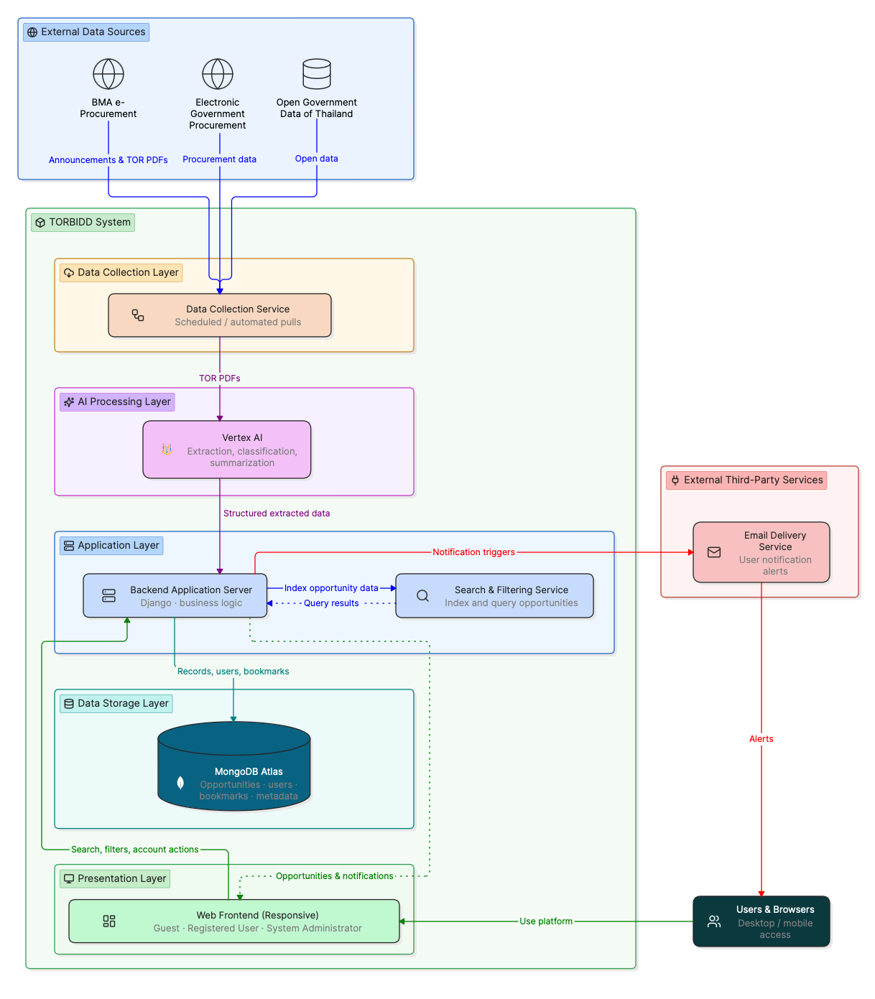

# System Architecture

## 1. Executive Architecture Summary

TORBIDD (**Software Procurement Intelligence Platform**) is a modern, full-stack intelligence platform built on **Next.js 16 (App Router)**, **React 19**, **TypeScript**, **MongoDB Atlas**, and **Google Cloud Vertex AI (Gemini 1.5)**.

The platform continuously aggregates public software procurement notices and Terms of Reference (TOR) specifications from Thai government portals, extracts and classifies software opportunities with Large Language Models (LLMs), evaluates bidder qualifications, benchmarks historical award prices, and delivers proactive notifications to technology vendors.

---

## 2. Multi-Tier System Decomposition

### 2.1 Presentation Tier (Client Layer)
- **Framework**: Next.js 16 App Router using React 19 Client & Server Components.
- **State & Context**:
  - `ThemeContext`: Dark and light mode toggle with system preference auto-detection.
  - `LanguageContext`: Full bilingual support (Thai - ภาษาไทย & English) with Buddhist Era (B.E.) date handling.
  - `ToastContext`: Dynamic notifications for bookmarking, sync feedback, and error handling.
  - `AuthContext`: Role-aware session state (`admin` vs. `user`).
- **Data Visualization**: Chart.js and `react-chartjs-2` for historical pricing distributions, budget breakdowns, and agency spending comparisons.

### 2.2 Server & Route Handler Tier (Application Logic)
- **Runtime**: Node.js v20+ inside Next.js Route Handlers (`src/app/api/*`).
- **Validation**: Schema-level input enforcement via **Zod** on all mutation and query inputs.
- **Services**:
  - `services/ingestion/`: Ingestion pipelines for municipal and national procurement endpoints.
  - `services/transformation/`: Normalizes non-standard Thai dates, parses currency formats, and standardizes agency names.
  - `services/ai/`: Wrappers for Google Cloud Vertex AI SDK.
  - `services/notifications/`: Matching rules, notification deduplication, and deadline scanners.

### 2.3 AI Intelligence Tier
- **Provider**: Google Cloud Vertex AI hosted in `asia-southeast1` (Singapore).
- **Models**:
  - `gemini-1.5-flash`: Fast classification determining whether an announcement is custom software, COTS, IT infrastructure, or non-software.
  - `gemini-1.5-pro`: Deep multimodal extraction of legal, financial, and technical bidder qualification clauses from PDF/DOCX Terms of Reference.
- **Resilience**: Zero client-side credential exposure. If cloud credentials are missing in local development, the system seamlessly falls back to offline mock datasets.

### 2.4 Data Tier (MongoDB Atlas)
- **Database Engine**: MongoDB Atlas Cluster running MongoDB 7.0+.
- **ODM**: Mongoose with singleton connection pooling to eliminate connection exhaustion across serverless and hot-reload states.
- **Collections**: Discovered Procurements, Historical Benchmarks, User Bookmarks, Notifications, User Settings, Sync Logs, and Dead-Letter Queue (DLQ).

---

## 3. External Data Ingestion Pipelines

| Source Name | Endpoint / Protocol | Data Scope | Extraction Mechanism |
|---|---|---|---|
| **Bangkok Metropolitan Administration (BMA)** | `http://egp2.bangkok.go.th/` | Municipal procurement notices & downloadable TOR documents across 50 district offices | HTML parsing, pagination crawl, and PDF document download |
| **Electronic Government Procurement (e-GP)** | `http://www.gprocurement.go.th/` | National ministry and department procurement opportunities | REST / SOAP public open endpoints & RSS feeds |
| **Open Government Data of Thailand (DGA)** | `https://data.go.th/` | Historical awarded contracts, budgets, and winner records | Public CKAN REST APIs |

---

## 4. Cross-Cutting Concerns & Security

1. **Security & Secrets**: Vertex AI service account credentials, database connection strings, and administrative tokens are strictly server-side and accessed via environment variables.
2. **Idempotency & Deduplication**: All ingested notices receive a unique `contentHash` and `externalProjectId` index to guarantee that re-syncing never creates duplicates.
3. **Resilience & DLQ**: Upstream failures trigger an exponential backoff policy (up to 3 retries). Unrecoverable failures are written to `SyncError` (Dead-Letter Queue) for administrator inspection.
4. **Bilingual Accessibility**: Every user-facing model stores bilingual objects `{ th: string, en: string }` with Buddhist Era formatting (`พ.ศ. = ค.ศ. + 543`).