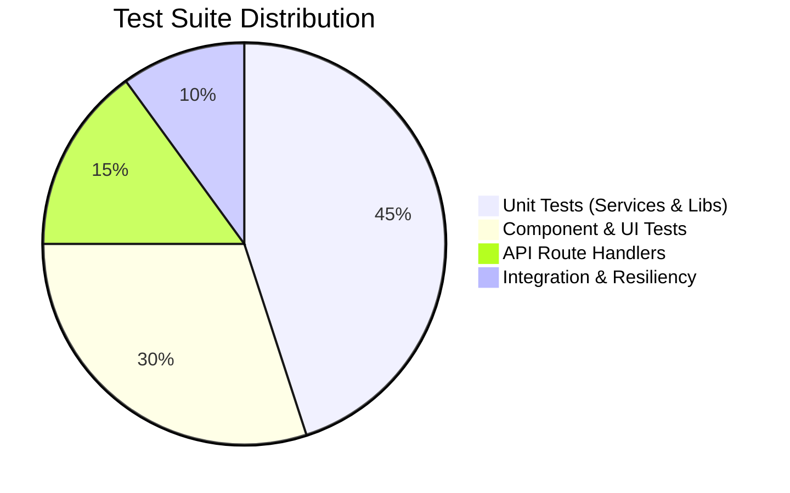

# Testing & Quality Assurance Documentation

## 1. Testing Strategy

TORBIDD implements a multi-tier testing strategy ensuring that business logic, AI response schemas, resilient data pipelines, and user interface components are rigorously verified.



---

## 2. Test Architecture & Frameworks

| Layer | Framework | Scope | Directory |
|---|---|---|---|
| **Unit Testing** | Jest + `ts-jest` | Normalizers, statistics, validators, retry policies, matching rules | `src/lib/__tests__/`<br>`src/services/**/__tests__/` |
| **Component Testing** | React Testing Library + Jest DOM | Client components, filters, modals, cards, topbar | `src/components/**/__tests__/`<br>`src/app/**/__tests__/` |
| **API Route Testing** | Node HTTP Mocks + Jest | Request validation, status codes, query filters | `src/app/api/**/__tests__/` |
| **Type Verification** | TypeScript Strict Mode (`tsc`) | Complete end-to-end type safety | Full codebase |

---

## 3. Executing Tests

### 3.1 Run Test Suite
```bash
cd torbidd-app
npm test
```

### 3.2 Run Tests with Coverage Report
```bash
npm test -- --coverage
```

### 3.3 TypeScript Strict Type Check
```bash
npm run build
```

---

## 4. Test Suites Inventory

### 4.1 Ingestion & Resilience Tests
- `services/ingestion/__tests__/bma-client.test.ts`: Verifies parsing of BMA announcement listings and document links.
- `services/ingestion/__tests__/egp-client.test.ts`: Validates e-GP feed ingestion.
- `services/resilience/__tests__/retry-policy.test.ts`: Confirms exponential backoff behavior under 500-series network errors.
- `services/database/__tests__/dlq.test.ts`: Verifies unrecoverable records are captured in `SyncError`.

### 4.2 Data Transformation & Date Normalizer Tests
- `services/transformation/__tests__/date-normalizer.test.ts`: Confirms conversion between Thai Buddhist Era (B.E. 2568) and ISO Gregorian dates.
- `services/transformation/__tests__/currency-normalizer.test.ts`: Tests currency symbol stripping, commas, and decimal rounding.

### 4.3 AI Extraction & Classification Tests
- `services/ai/__tests__/classifier.test.ts`: Evaluates few-shot prompts across diverse project descriptions.
- `services/ai/__tests__/tor-extractor.test.ts`: Asserts extraction of mandatory capital and certification clauses.

### 4.4 Analytics & Algorithms
- `lib/__tests__/historicalAnalytics.test.ts`: Validates 5-number summary (Min, Q1, Median, Q3, Max) and Tukey box-plot outlier detection.
- `services/notifications/__tests__/procurement-matching.test.ts`: Tests matching engine rules against category and budget constraints.
- `services/notifications/__tests__/deadline-scanner.test.ts`: Verifies alerts trigger at the 72-hour and 24-hour thresholds.