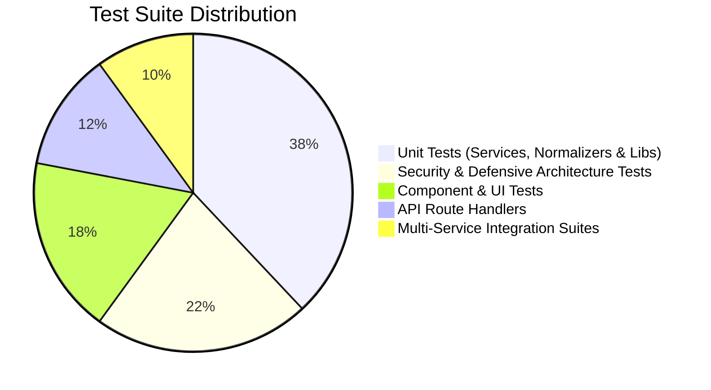

# Testing & Quality Assurance Documentation

[← Back to Wiki Home](Home) · [Requirement Traceability](Requirement-Traceability) · [Technical Decisions](Technical-Decisions)

## 1. Testing Strategy

TORBIDD implements a multi-tier testing strategy ensuring that business logic, AI response schemas, resilient data pipelines, security controls, and user interface components are rigorously verified.



---

## 2. Test Architecture & Frameworks

| Layer | Framework | Scope | Directory |
|---|---|---|---|
| **Unit Testing** | Jest + `ts-jest` | Normalizers, statistics, validators, retry policies, matching rules, translation | `src/lib/__tests__/`<br>`src/services/**/__tests__/` |
| **Security Verification** | Jest | ASVS Chapters V5–V17, SSRF allowlists, path traversal containment, secrets validation, cookie security | `src/__tests__/sec-*`<br>`src/lib/__tests__/` |
| **Component Testing** | React Testing Library + Jest DOM | Client components, split-pane triage inspector, filters, modals, cards, topbar | `src/components/**/__tests__/`<br>`src/app/**/__tests__/` |
| **API Route Testing** | Node HTTP Mocks + Jest | Request validation, auth gating, status codes, query filters, error boundaries | `src/app/api/**/__tests__/` |
| **Integration Testing** | In-Memory MongoDB + Jest | Cross-service workflows, ingestion pipelines, diff & scheduled notification runs | `src/**/*.integration.test.ts` |
| **Type Verification** | TypeScript Strict Mode (`tsc`) | Complete end-to-end type safety | Full codebase |

---

## 3. Executing Tests

### 3.1 Run Complete Test Suite
```bash
cd torbidd-app
npm test
```

### 3.2 Run Tests with Coverage Report
```bash
npm test -- --coverage
```

### 3.3 Run Security Test Suites Only
```bash
npm test -- src/__tests__/sec-
npm test -- src/app/api/documents/
npm test -- src/lib/__tests__/ssrf.test.ts
npm test -- src/lib/__tests__/production-secrets.test.ts
```

### 3.4 TypeScript Strict Type Check & Build
```bash
npm run build
```

---

## 4. Test Suites Inventory

### 4.1 Security & Defensive Architecture Tests (OWASP ASVS v4.0.3 Level 2)
- `src/__tests__/sec-19-environment-hardening.test.ts`: Verifies production secret length, placeholder detection, and `.dockerignore` containment.
- `src/__tests__/sec-20-data-protection.test.ts`: Verifies `__Host-` session cookies, HSTS headers, and sensitive log redaction.
- `src/__tests__/sec-21-defensive-architecture.test.ts`: Asserts rate limiting, 25MB payload caps, and input sanitization.
- `src/__tests__/sec-22-audit-logging-error-handling.test.ts`: Confirms generic error responses in production and audit logging.
- `src/__tests__/sec-23-webrtc-exclusion.test.ts`: Asserts WebRTC boundaries are preserved.
- `src/lib/__tests__/ssrf.test.ts`: Verifies government domain allowlist, private IP rejection (10.0.0.0/8, 172.16.0.0/12, 192.168.0.0/16, 127.0.0.1, 169.254.169.254).
- `src/app/api/documents/[projectId]/[fileName]/__tests__/containment-defense.test.ts`: Tests path traversal attacks (`../`, `%2e%2e%2f`) against cached documents.
- `src/lib/__tests__/cookie-security.test.ts`: Validates `Secure`, `HttpOnly`, `SameSite=Lax`, and `__Host-` prefix enforcement.
- `src/lib/__tests__/security-headers.test.ts`: Validates CSP, HSTS, X-Frame-Options, and Referrer-Policy headers.
- `src/lib/__tests__/production-secrets.test.ts`: Verifies fail-secure startup on weak or default `SESSION_SECRET`.
- `src/lib/__tests__/tls.test.ts`: Validates TLS 1.2+ minimum protocol requirement.
- `src/app/api/security/csp-report/__tests__/route.test.ts`: Verifies CSP violation report ingestion.

### 4.2 Ingestion & Data Transformation Tests
- `src/services/ingestion/__tests__/bma-client.test.ts`: Verifies parsing of BMA announcement listings and document links.
- `src/services/ingestion/__tests__/egp-client.test.ts`: Validates e-GP RSS XML feed parsing and pagination.
- `src/services/ingestion/__tests__/govspending-client.test.ts`: Validates open spending dataset parsing from Data.go.th.
- `src/services/ingestion/__tests__/bma-egp-ingestion.integration.test.ts`: End-to-end ingestion pipeline integration across multiple sources.
- `src/services/resilience/__tests__/retry-policy.test.ts`: Confirms exponential backoff behavior under 500-series network errors.
- `src/services/database/__tests__/dlq.test.ts`: Verifies unrecoverable records are captured in `SyncError`.
- `src/services/transformation/__tests__/date-normalizer.test.ts`: Confirms bidirectional conversion between Thai Buddhist Era (B.E.) and ISO Gregorian dates.
- `src/services/transformation/__tests__/currency-normalizer.test.ts`: Tests currency symbol stripping, commas, and decimal rounding.
- `src/services/transformation/__tests__/tech-taxonomy.test.ts`: Validates technology keyword taxonomy and tagging.

### 4.3 AI Extraction & Classification Tests
- `src/services/ai/__tests__/classifier.test.ts`: Evaluates few-shot prompts across diverse Thai project descriptions.
- `src/services/ai/__tests__/tor-extractor.test.ts`: Asserts extraction of mandatory five pillars and qualification clauses.
- `src/services/ai/__tests__/qualification-validator.test.ts`: Verifies Go/No-Go validation logic for bidder qualifications.
- `src/services/ai/adapters/__tests__/fallback-adapter.test.ts`: Tests automatic failover across AI providers on HTTP 429 rate limits.
- `src/services/ai/__tests__/ai-fallback-dlq.integration.test.ts`: End-to-end AI fallback to dead-letter queue.

### 4.4 Notifications & Email Alerts Tests
- `src/services/notifications/__tests__/email-delivery.test.ts`: Validates Nodemailer transporter creation, mock transport, and HTML generation.
- `src/services/notifications/__tests__/procurement-matching.test.ts`: Tests matching engine rules against category, budget, and preference combinations.
- `src/services/notifications/__tests__/deadline-scanner.test.ts`: Verifies alerts trigger at 72-hour and 24-hour thresholds.
- `src/services/notifications/__tests__/procurement-diff.test.ts`: Tests substantive change detection on bookmarked opportunities.
- `src/services/notifications/__tests__/diff-and-scheduled-notifications.integration.test.ts`: Full integration across diffing, alert generation, and notification delivery.
- `src/app/api/cron/deadline-reminders/__tests__/route.test.ts`: Validates fail-secure `CRON_SECRET` authentication and rate limiting.

### 4.5 Historical Analytics & Statistical Algorithms
- `src/lib/__tests__/historicalAnalytics.test.ts`: Validates Five-Number summary (Min, Q1, Median, Q3, Max), mean, IQR, and Tukey outlier detection.
- `src/components/historical/__tests__/HistoricalComponents.test.tsx`: Asserts correct rendering of metric cards, box plots, contract vs budget spread, and empty states.

### 4.6 Administration Console & Translation Tests
- `src/components/admin/__tests__/AdminPanel.test.tsx`: Validates header stats strip, triage pills, and project list.
- `src/components/admin/__tests__/ProjectInspectorDrawer.test.tsx`: Tests split-pane opening, inline quick edits, and AI translation triggers.
- `src/app/api/admin/__tests__/admin-routes.integration.test.ts`: Verifies admin authorization, RBAC gating, and update endpoints.
- `src/app/api/admin/translate/__tests__/route.test.ts`: Asserts AI translation route behavior and fallback responses.
- `src/services/translation/__tests__/auto-translation.test.ts`: Tests Thai-to-English translation caching and dictionary rules.

### 4.7 Component & UI Integration Tests
- `src/components/procurement-filters/__tests__/ProcurementComponents.test.tsx`: Tests filter panel, sliders, and cards.
- `src/components/ui/__tests__/EligibilityChecklist.test.tsx`: Tests interactive Go/No-Go qualification gates.
- `src/components/ui/__tests__/ProjectCarousel.test.tsx`: Validates homepage featured projects carousel.
- `src/components/ui/__tests__/TechStackRequirements.test.tsx`: Validates tech requirement pills.
- `src/hooks/__tests__/useBookmarks.test.tsx`: Asserts optimistic bookmark saving, removal, and server synchronization.
- `src/contexts/__tests__/LanguageContext.test.tsx`: Validates Thai/English bilingual switching and date localization.
