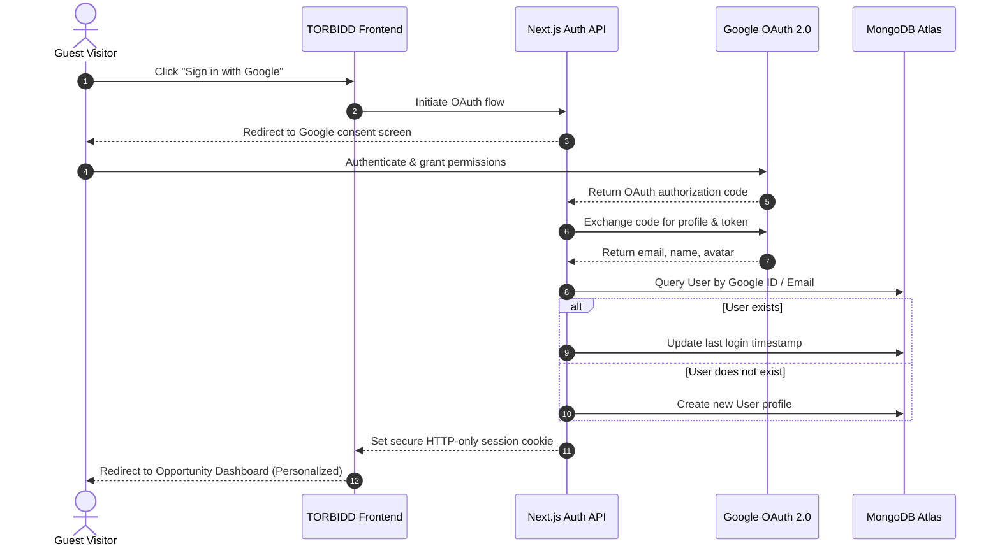

## 3.2 User Authentication and Access Control

### Description & Priority
Allows users to securely authenticate using Google Sign-In before accessing personalized platform features. All personalization capabilities (bookmarks, comparisons, alert notifications) are strictly restricted to authenticated users.  
**Priority:** `Medium`

### Functional Requirements
- **AUTH-1**: The system shall allow users to authenticate using Google Sign-In.
- **AUTH-2**: The system shall restrict access to all personalized system features to authenticated users only (bookmarks, comparison, notification).
- **AUTH-3**: The system shall prompt unauthenticated visitors to sign in before accessing personalized content.

---

### UC-1: Sign In with Google OAuth

| Item | Details |
|---|---|
| **Use Case ID** | **UC-1** |
| **Use Case Name** | Sign In with Google OAuth |
| **Primary Actor** | Guest / Unauthenticated Visitor |
| **Supporting Actor** | Google OAuth 2.0 Authentication Service |

#### Description
A visitor signs in to TORBIDD using their Google account to access personalized features such as bookmarks, comparisons, saved opportunities, and notifications. If the Google account is not yet associated with a TORBIDD account, the system automatically provisions a new account using information provided by Google.

#### Preconditions
1. The visitor can access the TORBIDD website.
2. The visitor is not currently authenticated.
3. The visitor possesses a valid Google account.

#### User Flow Diagram

#### Main Flow
1. The visitor opens the TORBIDD sign-in page.
2. The system displays the **Sign in with Google** button.
3. The visitor selects **Sign in with Google**.
4. The system redirects the visitor to Google's OAuth authentication page.
5. The visitor authenticates with their Google account and grants required permissions.
6. Google returns an OAuth authorization result to TORBIDD.
7. The system validates the OAuth result and retrieves required Google profile data.
8. The system checks whether the Google account is already associated with a TORBIDD account.
9. *If found*: The system authenticates the existing visitor.
10. *If not found*: The system creates a new TORBIDD account using the Google account profile.
11. The system creates an authenticated session.
12. The system redirects the visitor to the procurement opportunity dashboard.
13. Personalized features (bookmarks, comparisons, notifications) become active.

#### Postconditions
- The visitor is successfully authenticated or a new TORBIDD account is provisioned.
- An authenticated session is established.
- The visitor is redirected to the dashboard with personalized features enabled.