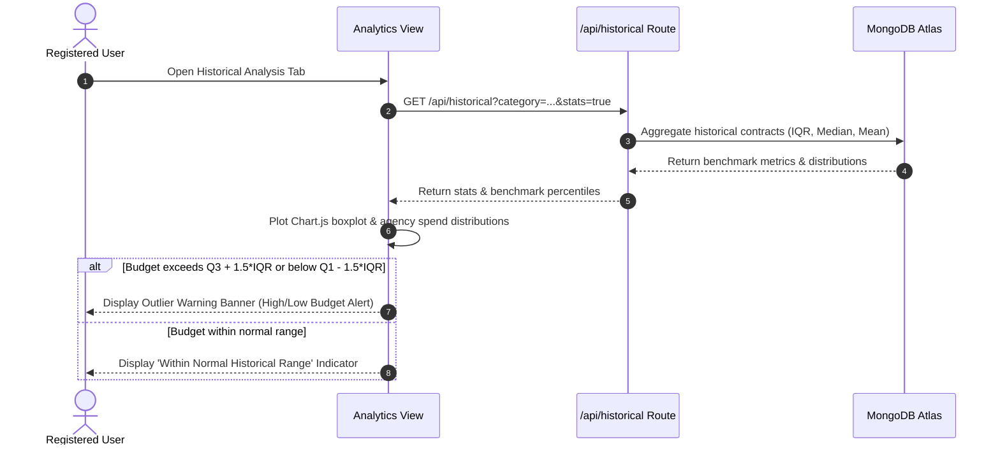

## 3.9 Historical Price Dashboard & 3.10 Outlier Analysis

### Description & Priority
Provides comparative analytics and historical budget benchmarking across past government software contracts to support bid pricing decisions and detect statistical outliers.  
**Priority:** `High`

### Functional Requirements
- **HPD-1**: Display historical software procurement projects for comparison.
- **HPD-2 to HPD-4**: Filter historical data by Year, Department, and Category.
- **BOA-1**: Compare current project budget with historical software contracts.
- **BOA-2**: Generate visual warnings if the budget is an outlier compared to historical medians/averages.

---

### UC-7: View Historical Budget and Outlier Analysis

| Item | Details |
|---|---|
| **Use Case ID** | **UC-7** |
| **Use Case Name** | View Historical Budget and Outlier Analysis |
| **Primary Actor** | Registered User |

#### Preconditions
1. Opportunity contains valid budget and category data.
2. Historical records exist in the database for the matching category.

#### User Flow Diagram

#### Main Flow
1. User opens opportunity detail page and navigates to the Historical Price Analysis tab.
2. System queries past projects in the same category.
3. System calculates statistics (median, mean, Q1, Q3, IQR).
4. System plots comparative distribution charts.
5. System evaluates the project budget against historical benchmarks.
6. System indicates whether the budget is within normal range or an outlier.
7. User reviews data to inform bid pricing.

#### Postconditions
- Benchmark metrics rendered; underlying opportunity record is unmodified.
